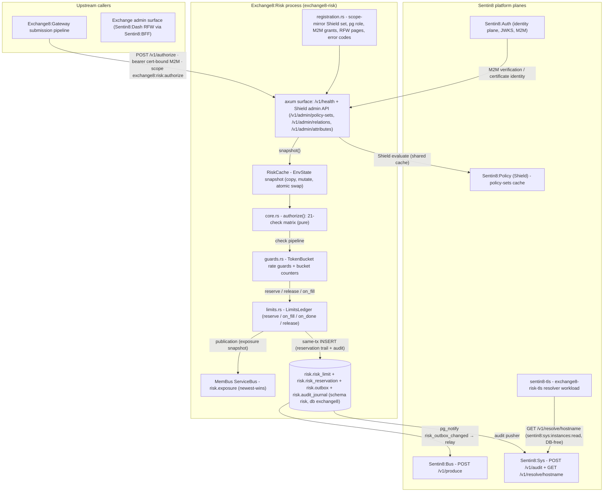

# Exchange8:Risk

## 1. Summary

Exchange8:Risk (service type `exchange8:risk`, binary `exchange8-risk`) is the
**synchronous pre-trade authorization service** of the exchange8 vertical -
the capital-markets matching tier of the Sentin8 platform. Every order the
Exchange8:Gateway submission pipeline accepts is evaluated here, against a fixed
**21-check authorization matrix**, before any of it may reach Exchange8:ME:
session and instrument state, book tokens and entitlements, order shape
(ord type, TIF, tick, lot, iceberg floor, peg, cross, bypass, post-only,
STP shape), the shortable matrix, Large-In-Scale gating for hidden orders,
price protection, the notional credit limit, and per-connection rate
guards. The hot path is a pure function - `authorize(order, &EnvState) ->
Decision` - over an atomically swapped snapshot of environment state; every
check is unit-testable without I/O, and the first failing check carries the
exact reject code from the behavior catalog
(`design/behavior-catalog/reject-codes.json`). Unknown state fails closed.

The mutable side of the limit model is an in-memory ledger: notional
reservations (booked at submit, converted to spent credit on fills,
released on kills/cancels), open-order slots, and message-rate token
buckets; its durable trail is `risk.risk_reservation`. The binary rides the
shared Sentin8 platform shell (`sentin8::shell`): axum HTTP/TLS surface,
`--print-registration` self-description, DB pool, `/v1/health`, the Shield
graceful drain. Event egress is the platform trio: in-process MemBus
publication (`risk.exposure` per-env exposure snapshots, newest-wins), the
local `risk.outbox` relayed to Sentin8:Bus, and the `risk.audit_journal`
pushed to Sentin8:Sys. Persistence is database `exchange8`, schema `risk`,
role `exchange8_risk_service` (no BYPASSRLS), DSN
`EXCHANGE8_RISK_DATABASE_URL`.

## 2. Motivation

- **Defensible admission control.** An exchange's first line of business
  defense is what it refuses to accept. Every reject is an exact,
  FIX-screenable code from the platform reject-catalog contract
  (`FIX 103/58` truth), so members' order-management systems can react
  programmatically and every rejection can be reconstructed under audit.
- **Credit protection before fill.** The notional credit limit is enforced
  as a *reservation ledger*: buying power is booked at submission, converts
  to spent credit only through fills, and returns to headroom on
  kill/cancel - exposure can never be double-committed.
- **Exchange-core protection from client storms.** A per-connection
  token-bucket rate guard (burst + sustained rate) fails closed, so a
  runaway feed throttles at the gate instead of loading the matching core.
- **A pure, testable core.** All authorization state is preloaded into an
  immutable snapshot; the 21-check function is pure, deterministic, and
  table-tested against the reject-code catalog - no database, clock, or
  allocator dependency on the hot path.
- **No bespoke infrastructure.** Identity, TLS, declarative policy,
  durable events, and audit delivery are platform planes (Sentin8:Auth,
  `sentin8-tls`, Shield, Sentin8:Bus, Sentin8:MemBus, Sentin8:Sys); the
  binary owns only the risk domain.

## 3. Architecture & High-Level Design

The service composition is deliberately small: one pure decision core
(`core.rs`), two stateful ledgers beside it (`guards.rs` rate/bucket
counters, `limits.rs` per-connection limit ledger + the snapshot cache),
and the shell wiring (`main.rs`, `registration.rs`). The HTTP surface
carries `/v1/health` and the shared Shield policy-admin API; the
`/v1/authorize` and `/v1/release` decision surfaces and the RFW admin
pages are declared at enrollment (mount state in the DESIGN's Open
Questions).

The shell boots registration, the DB pool (`EXCHANGE8_RISK_DATABASE_URL`),
the MemBus handle, and the router: `/v1/health` (shell) plus the shared
Shield policy-admin mount (`/v1/admin/policy-sets*`, `/v1/admin/relations*`,
`/v1/admin/attributes*`) over `HasPolicyAdmin`, so admin and request path
share one policy cache. The decision modules - `core.rs` (the 21-check
matrix), `guards.rs` (token buckets + limit buckets), `limits.rs` (the
reserve/release ledger and the snapshot cache) - carry no tokio, DB, or
clock dependencies, which is what makes the matrix exactly unit-testable
and the hot path I/O-free.

## 4. Key Traits and Data Structures

- **Decision** (`core.rs`) - the authorization result: allow with
  reservation ids to book in the same transaction, or reject with the exact
  `RejectCode` of the first failing check. Two outcomes only; the wire
  vocabulary (`exchange8::contracts::risk`) mirrors it as
  `AuthorizeResponse { decision, code }`.
- **EnvState snapshot** - the whole environment an authorization needs:
  market phase, per-instrument `InstrumentState` (status, tick bands,
  Large-In-Scale configuration, shortable cell, max size, peg/EBBO posture,
  allowed capacities and TIFs), and per-connection `ClientState`
  (suspension, enablement, book tokens, entitlements, notional and
  open-order limits, working count, rate permits). Readers clone the `Arc`;
  refreshes build a copy, mutate, and swap atomically - no torn reads.
- **LimitsLedger / ClientLedger** (`limits.rs`) - the mutable limit side
  per connection: reserved vs spent notional, open-order slots, and a
  per-second token-bucket (capacity, refill). `reserve()` runs the full
  pipeline in one call - rate permit, 21-check matrix, open-order slot,
  notional reservation - and fails with a distinct outcome per bucket
  (rate / open-orders / notional exceeded). Fills convert reservation to
  spent credit; completion frees the slot; releases saturate (never
  underflow).
- **TokenBucket / ReservationLedger** (`guards.rs`) - the general bucket
  machinery: continuous-refill token buckets deterministic under an
  injected clock (no hot-path syscalls), and `(bucket, scope)` limit
  counters (`Notional`, `OpenOrdersMax`) with reserve/release/seed and an
  audit journal. Unconfigured scopes fail closed.
- **Contracts** (`exchange8::contracts::risk`) - the Gateway↔Risk wire
  shapes (`AuthorizeRequest` is the normalized order, `AuthorizeResponse`
  the decision), plus the shared `RejectCode` catalog including the
  platform-added `RiskUnavailable`, `RateLimited`, and limit-guard codes.
- **Service identity** (`registration.rs`) - the seeded `scope-mirror`
  Shield policy set (action `exchange8:risk:authorize` over the live
  effective scope set and platform-admin scopes), the `exchange8_risk_service`
  PostgreSQL role (db `exchange8`, no BYPASSRLS), the M2M grant workloads
  (own client, `exchange8:risk-policy`/`risk-policy`, `risk-audit`,
  `exchange8-risk-tls`), the RFW admin pages (`limits`, `reservations`),
  and the registered error codes (`exchange8_risk_limit_exceeded` → 422,
  `exchange8_rate_guard_tripped` → 429).

## 5. Rationale, Trade-offs, and Alternatives

- **Pattern choices.**
  - *Pure core + thin shell.* The 21-check function is a stateless pure
    function over an immutable snapshot; the shell owns identity, HTTP,
    and persistence. Determinism makes the matrix table-testable row by row
    and keeps the synchronous gate's latency profile flat - a core that
    queries a database per order could never give the caller a bounded
    response.
  - *Snapshot, not shared mutable state.* Authorization state is read-mostly
    (instrument and customer configuration moves on events); the ledger is
    the write-mostly minority. Splitting them lets readers clone one
    `Arc` per request while a single owner mutates counters.
  - *Reserve-on-submit, release-on-event.* Notional credit is reserved when
    the order is authorized and released by lifecycle events
    (fill converts to spent, kill/cancel releases) - a day-so-far consumption
    model, seeded from Clearing, not a per-request recomputation.
- **Dispatching.** The check pipeline is a fixed sequence of plain
  comparisons with an early-return reject; market phase and shortable cells
  are small enums matched exhaustively. No trait objects and no dynamic
  strategy plugging: the matrix is a closed catalog whose exact reject codes
  are a wire contract, so the type-level closure is a feature, not a
  limitation.
- **Concurrency.** The hot path allocates no I/O: `snapshot()` is one
  `Arc` clone, the token bucket refills arithmetically against an injected
  clock (`now_us`/`now_s` supplied by the caller), and all notional math is
  checked/saturating fixed-point arithmetic. The MemBus publish handle is
  fail-soft (an unreachable Valkey degrades publishing, never the gate).
- **Rejected alternatives.**
  - *Per-order database checks (procedures over the limit tables):* couples
    the synchronous gate to pool health and adds a round trip to the
    budget; rejected in favor of the SOD snapshot + event refresh, with the
    reservation trail persisted for reconstruction.
  - *Fail-open defaults for unknown instruments, connections, or unconfigured
    limit scopes:* every unknown accepts-by-default would make a stale cache
    a silent control failure; the service rejects instead (the old spec's
    "unchecked flow when no limit configured" is deliberately not honored).
  - *Merging with Exchange8:Margin.* Position, mark-to-market, margining, and
    liquidation are asynchronous/stateful with a different failure model;
    this service stays synchronous-only, and consults margin requirements
    for derivative orders rather than computing them.
  - *Global lock around the ledger:* the ledger is single-writer by design;
    a reader-writer lock would add contention on the hottest path without a
    correctness need.

## 6. Internal Implementation & Invariants (Private Design)

- **Check order is contract.** The 21 checks run in the documented order
  and the first failure wins with its exact catalog code - clients screen
  on codes, so reordering would change observable behavior.
- **Fail-closed anchors.** Unknown connection → `ClientSuspended`-family
  reject; unknown instrument → id-side reject; missing book token or
  multi-book strategy → `WrongOrderBook`; reservation against an
  unconfigured bucket → deny. Nothing defaults to "open".
- **Pre-open discipline.** Only DAY + LIMIT passes the pre-open phase;
  postponed, halted, and closed phases reject outright; instrument-level
  halt/holiday reject before shape checks.
- **Shape lattice.** Iceberg floor must be positive, strictly below qty,
  and only on Day/GTC; FOK/IOC/post-only interact (post-only is rejected
  with IOC, FOK, or a floor; FOK disables STP); bypass requires IOC; cross
  orders require a valid cross type and the bypass marker; pegged orders
  require a peg type, with midpoint/dark requiring hidden and the EBBO/mid
  constraints per variant.
- **Lot partition.** Quantities split into board and odd parts against the
  instrument's lot size: a pure odd-lot order is rejected on lit books,
  a mixed order is rejected outright.
- **Notional math.** Priced orders compute `price × qty` with checked
  multiplication against the connection's notional limit; unpriced orders
  carry no in-core notional (the caller estimates at reference price before
  calling). Overflow of the checked multiply rejects `Internal` - an
  arithmetic anomaly is a defect, never an allowance.
- **Reserve ordering.** The reserve pipeline takes the rate permit first
  (so a rate-limited caller never consumes evaluation work), then runs the
  static matrix, then the open-order slot, then the notional reservation; a
  static reject makes no ledger movement.
- **Release discipline.** `release` and `on_done` saturate at zero - double
  releases from event replay are idempotent; `set_limit` refreshes the
  configured limit while preserving consumption; `seed_consumed` rebuilds
  day-so-far consumption at start-of-day.
- **Snapshot discipline.** Refresh is copy → mutate → swap of the whole
  `EnvState`; readers keep the old snapshot for the duration of their use,
  so a mid-update request never sees a partially updated instrument or
  client.
- **Invariants always true:** the same order + the same snapshot yield the
  same decision; no reservation is created against an unconfigured or
  exhausted bucket; released value never exceeds consumed; tenant tables
  are only touched with a set tenant context on the same connection; no
  code path bypasses Shield's step-5 decision.

## 7. Unresolved Questions / Future Designs

- The HTTP decision surfaces are declared and their handler shapes exist
  (`POST /v1/authorize`, `POST /v1/release`, the RFW `limits` /
  `reservations` data endpoints); the router currently mounts the Shield
  admin API and health only - the handler mounting is the open integration
  point.
- The SOD loader and the event-driven cache refresh (instrument state,
  customer state, limit definitions) are the remaining projection work:
  the snapshot contract (`RiskCache::from_sod` / `refresh`) is complete,
  the row → `EnvState` projection and the consumer wiring are open.
- The concrete outbound `event_type` strings for `risk.outbox` rows
  (the `exchange8:{service}:{resource}:{operation}` vocabulary is fixed;
  per-change mapping is the open writer surface), and the durable
  `risk.risk_reservation` row writes mirroring the in-memory ledger journal.
- Per-connection rate-limit configuration defaults (bucket capacity and
  sustained rate per connection class) - the mechanism is implemented and
  tested; the venue-wide defaults are a business configuration decision.
- The replace-validation matrix (cancel/replace inherits the session,
  book, and price/notional re-checks) mounts at the same authorize surface.
- Synchronous pre-trade options checks consulting an Exchange8:Margin margin
  requirement (the cross-service hook) are deferred to the derivatives
  extension design.

---

**Design attribution:** exchange8:risk and its underlying concepts were designed by Hamid Jahanzad <Hamid@Jahanzad.com>.
